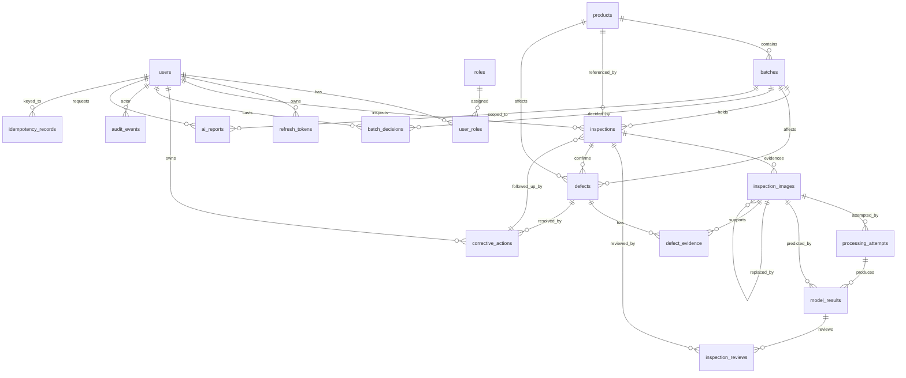

# Database Schema (PostgreSQL 18)

Authoritative DDL: `backend/src/main/resources/db/migration/V*.sql` (Flyway).
This document is the readable map of that schema.

## ER diagram

## Tables

### Identity & auth (V1)
| Table | Purpose | Key columns |
|---|---|---|
| `users` | Login identities | `id`, `org_id`, `username` (unique), `password_hash`, `display_name`, `enabled`, timestamps |
| `roles` | `INSPECTOR`, `SUPERVISOR`, `QUALITY_MANAGER` | `id`, `code` (unique) |
| `user_roles` | M:N assignment | `(user_id, role_id)` PK |
| `refresh_tokens` | Rotating refresh tokens | `token_hash` (SHA-256, unique), `user_id`, `expires_at`, `revoked_at`, `replaced_by_id` |
| `idempotency_records` | Duplicate-submission replay | `(user_id, idem_key)` unique, `request_hash`, `response_status`, `response_body` JSONB |

### Core quality records (V2)
| Table | Purpose | Key columns / constraints |
|---|---|---|
| `products` | Product master | `code` unique, `name`, `category`, `description`, `specifications` JSONB, `status` ACTIVE/ARCHIVED |
| `batches` | Production lots | `code` unique, `product_id` FK, `production_date`, `quantity_produced`, `status` ACTIVE/ARCHIVED, `production_line`, `supplier` |
| `inspections` | One row per inspected *physical item/sample* | `batch_id`, `product_id`, `item_reference`, `item_key` (generated), `evidence_scope` ITEM/SURFACE/BATCH_SAMPLE, `inspection_type` INITIAL/FOLLOW_UP, `status` DRAFT/SUBMITTED/CANCELLED, `corrective_action_id` (follow-ups), `parent_inspection_id`, unique partial index on `(batch_id, item_key)` for INITIAL non-cancelled rows |
| `inspection_images` | Versioned evidence files | `storage_key`, `original_filename`, `content_type`, `size_bytes`, `sha256`, `version`, `is_current`, `replaced_by_id` |
| `processing_attempts` | Every ML attempt incl. failures | `attempt_no`, `status` PENDING/PROCESSING/COMPLETED/FAILED, `error_details`, `duration_ms`, `model_name`, `model_version` |
| `model_results` | Raw model output (never edited) | `predicted_class` GOOD/POTENTIALLY_DEFECTIVE, `score` NUMERIC(6,4) NULL, `score_type` NULL, `model_name`, `model_version`, `processed_at`, `duration_ms`, `is_current` |
| `inspection_reviews` | Human decisions (separate from ML) | `model_result_id`, `decision` CONFIRM/CORRECT/MANUAL_REQUIRED/EVIDENCE_REQUESTED, `confirmed_outcome` GOOD/POTENTIALLY_DEFECTIVE/NEEDS_MANUAL NULL, `reason` (required unless plain confirm), `reviewer_id`, `created_at` |

### Defects & actions (V3)
| Table | Purpose | Key columns / constraints |
|---|---|---|
| `defects` | Human-confirmed findings | `code` unique (DEF-#####), `inspection_id`, `batch_id`, `product_id`, `item_key`, `category` (nullable, human-assigned), `severity` LOW/MED/HIGH/CRITICAL, `review_status`, `status` OPEN/CLOSED/REOPENED, `confirmation_reason` |
| `defect_evidence` | Images backing a defect | `(defect_id, image_id)` PK |
| `corrective_actions` | Remediation work | `code` unique (CA-#####), `defect_id`, `owner_id`, `target_date`, `status` OPEN/IN_PROGRESS/AWAITING_REINSPECTION/COMPLETED/CANCELLED, `work_notes`, `completion_details` |
| `batch_decisions` | HOLD/RELEASE history | `batch_id`, `decision`, `reason` (NOT NULL), `decided_by`, `decided_at` — latest row = current decision |
| `ai_reports` | GenAI outputs + grounding | `report_type`, `scope` JSONB, `request_text`, `response_text`, `grounding_json` JSONB, `mode` llm/dev-no-llm, `status` |

### Audit (V4)
| Table | Purpose | Key columns |
|---|---|---|
| `audit_events` | Append-only timeline | `entity_type`, `entity_id`, `action`, `actor_id`, `actor_username`, `reason`, `details` JSONB, `occurred_at` + trigger blocking UPDATE/DELETE |

## Counting rules (used by dashboard SQL)

- **Distinct items inspected (batch B):**
  `COUNT(DISTINCT item_key) FROM inspections WHERE batch_id=B AND status='SUBMITTED' AND item_key IS NOT NULL`
- **Distinct items with confirmed defects:** distinct `defects.item_key`
  (`defects.status <> 'CANCELLED'`) — model predictions excluded.
- **Defect rate:** `confirmed_defective_items / distinct_items_inspected`
  (denominator always reported alongside).
- **Overdue actions:** `target_date < current_date AND status NOT IN
  ('COMPLETED','CANCELLED')`.
- Multiple images or follow-up inspections of the same `item_key` never inflate
  these counts.
